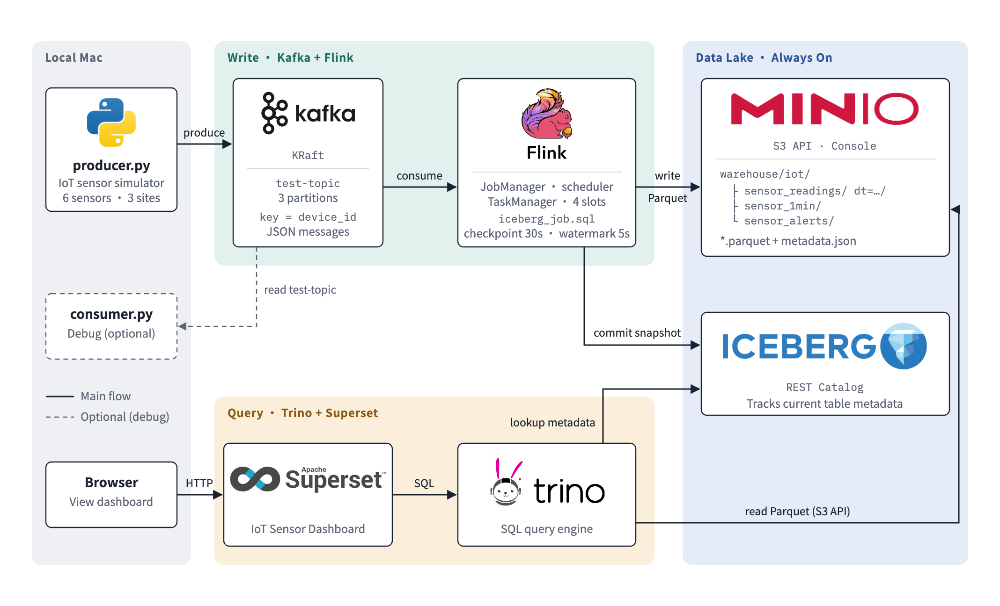

# Streaming Lakehouse: A Modern Data Stack for IoT 

使用 Docker 在本機建立一條完整的串流資料湖 pipeline：模擬 IoT 感測器資料，經 Kafka 進入 Flink 處理，寫成 Iceberg 表存放在 MinIO，再用 Trino 查詢、Superset 視覺化。


## 架構



| 層 | 元件 | 版本 | 角色 |
|---|---|---|---|
| 資料來源 | `producer.py` | Python 3.9+ | 模擬 6 台溫溼度感測器 |
| 訊息佇列 | Apache Kafka | 4.0.0 (KRaft) | 緩衝資料流 |
| 串流處理 | Apache Flink | 1.20.1 | 讀 Kafka、做 window 聚合與告警、寫入 Iceberg |
| 表格式 | Apache Iceberg | 1.9.1 | 把 MinIO 上的 Parquet 檔管理成表（ACID、快照、schema 演進） |
| Catalog | Iceberg REST Catalog | 1.9.1 | 記錄每張表目前的 metadata 位置 |
| 物件儲存 | MinIO | 2025.4.22 | 相容 S3，存放 Parquet 與 metadata |
| 查詢引擎 | Trino | 476 | 用 SQL 查 Iceberg 表 |
| 視覺化 | Apache Superset | 5.0.0 | 儀表板 |

Flink 與 Trino 不直接溝通：Flink 寫檔並向 REST Catalog 登記表版本，Trino 照登記去讀同一批檔案。因此寫入組關掉後，查詢組仍然能查到資料。

## 專案結構

```
.
├── producer.py                    # IoT 感測器模擬器 -> Kafka
├── consumer.py                    # 除錯工具：直接讀 Kafka topic (不在主流程中)
├── requirements.txt
├── architecture.png               # 架構圖
├── docker-compose.yml             # 所有服務
├── flink/
│   ├── Dockerfile                 # Flink + Kafka connector + Iceberg / S3 / Hadoop jar
│   └── sql/
│       ├── init.sql               # 把 Kafka test-topic 定義成資料表 test_topic
│       └── iceberg_job.sql        # 寫入三張 Iceberg 表
├── trino/catalog/
│   └── iceberg.properties         # Trino 連 REST Catalog 與 MinIO
└── superset/
    ├── Dockerfile                 # Superset + Trino driver
    ├── bootstrap.sh               # 啟動時建立 admin 帳號與 Trino 連線
    ├── superset_config.py
    └── setup_dashboard.py         # 用 REST API 建立儀表板
```

## 模擬資料

6 台感測器分布在 3 個位置，每台每次回報一筆 JSON（key 為 `device_id`）：

```json
{"device_id": "sensor-03", "location": "warehouse-b", "seq": 128,
 "temperature": 27.41, "humidity": 58.2, "battery": 86.4, "ts": 1792411021538}
```

| 裝置 | 位置 | 基準溫度 |
|---|---|---|
| sensor-01、02 | office-1f | 24°C |
| sensor-03、04 | warehouse-b | 27°C |
| sensor-05、06 | server-room | 21°C（sensor-06 是快沒電的舊裝置） |

為了貼近真實情境，模擬器會產生：

- **平滑的溫度變化**：每次只在前一次的溫度上小幅變動
- **過熱事件**：數十秒內升溫約 12°C 再慢慢降回，觸發告警
- **溼度與電量**：溼度隨溫度反向變動，電量隨回報次數下降
- **網路延遲**：約 3% 的資料晚 1～8 秒才送達（`ts` 是量測時間），用來練習 watermark
- **封包遺失**：約 1% 的資料直接遺失，可從 `seq` 斷號算出

## Iceberg 表

`iceberg_job.sql` 把三個 `INSERT` 包成一個 Flink job，寫入 `iot` namespace：

| 表 | 內容 |
|---|---|
| `sensor_readings` | 每一筆原始讀數，含量測時間與 Kafka 收到時間，依日期 (`dt`) 分區 |
| `sensor_1min` | 每台裝置每分鐘的平均 / 最低 / 最高溫度、平均溼度、最低電量、筆數 |
| `sensor_alerts` | 溫度 > 32°C 的告警（> 35°C 為 `CRITICAL`） |

Iceberg 只在 Flink checkpoint 完成時才 commit 資料，所以 job 設定每 30 秒 checkpoint 一次。

## 環境需求

- Docker Desktop，**記憶體至少 4 GB**（Settings → Resources）
- Python 3.9 以上

全部服務同時執行約需 4 GB 記憶體。Docker 只有 4 GB 時，請依下方步驟讓「寫入組」與「查詢組」輪流執行；調到 6 GB 以上就能全部一起開。

## 快速開始

### 0. 安裝 Python 套件

```bash
python3 -m venv venv
source venv/bin/activate
pip install -r requirements.txt
```

### 1. 寫入資料（資料湖 + 寫入組）

```bash
# 啟動資料湖與寫入組
docker compose up -d minio iceberg-rest
docker compose up -d kafka jobmanager taskmanager

# 送 1 輪資料，讓 test-topic 存在
python producer.py 1

# 送出 Flink job (只執行一次，重複執行會產生重複資料)
docker compose run --rm sql-client bin/sql-client.sh \
  -i /opt/flink/sql/init.sql -f /opt/flink/sql/iceberg_job.sql

# 持續送資料，跑 5 分鐘以上後按 Ctrl+C，再等 30 秒讓最後一次 checkpoint 完成
python producer.py 0 1
```

到 MinIO 管理介面查看 `warehouse/iot/` 底下的 Parquet 檔。

### 2. 查詢與視覺化（查詢組）

```bash
# 關掉寫入組釋放記憶體，資料湖保持開著
docker compose stop kafka jobmanager taskmanager
docker compose up -d trino superset

# 建立 Superset 儀表板 (Superset 初始化約需 1～2 分鐘)
python superset/setup_dashboard.py
```

打開 Superset → Dashboards → **IoT 感測器監控**。

用 Trino CLI 直接查詢：

```bash
docker exec -it trino trino
```

```sql
SELECT device_id, max(temperature) AS max_temp, min(battery) AS battery
FROM iceberg.iot.sensor_readings
GROUP BY device_id ORDER BY device_id;
```

### 3. 結束

```bash
docker compose stop        # 停止所有容器，資料保留
docker compose down -v     # 刪除所有容器與資料 (無法復原)
```

## 服務與網址

| 服務 | 網址 | 帳號 / 密碼 |
|---|---|---|
| Kafka UI（選用） | http://localhost:8080 | — |
| Flink Web UI | http://localhost:8081 | — |
| MinIO Console | http://localhost:9001 | `admin` / `password` |
| Iceberg REST Catalog | http://localhost:8181 | — |
| Trino Web UI | http://localhost:8082 | 任意帳號 |
| Superset | http://localhost:8088 | `admin` / `admin` |
| Kafka（給本機程式） | `localhost:9092` | — |

容器之間使用 `kafka:29092` 連 Kafka；本機程式使用 `localhost:9092`。

## producer.py 用法

```bash
python producer.py [rounds] [interval]
```

| 指令 | 效果 |
|---|---|
| `python producer.py 1` | 送 1 輪（6 筆）就結束 |
| `python producer.py 0 1` | 每秒 1 輪（每秒 6 筆），不停送 |
| `python producer.py 0 0.5` | 每 0.5 秒 1 輪（每秒 12 筆） |

## 除錯工具：consumer.py

不在主流程中（Flink 本身就是 Kafka 的 consumer），用來確認資料有沒有進 Kafka：

```bash
python consumer.py debug-group test-topic
```

也可以用 Kafka UI，或 Kafka 內建的指令：

```bash
docker exec -it kafka /opt/kafka/bin/kafka-console-consumer.sh \
  --bootstrap-server localhost:9092 --topic test-topic
```

## 實作上的注意事項

- **MinIO image**：MinIO 官方已停止在 Docker Hub 發布社群版 image，本專案改用 Bitnami 封存的 `bitnamilegacy/minio:2025.4.22`（不會再更新，僅適合本機練習）。
- **REST Catalog 用 SQLite 儲存**：SQLite 同時只能有一個寫入者，而 Flink 每次 checkpoint 會同時 commit 三張表，因此設定 `CATALOG_CLIENTS: "1"` 讓 commit 排隊，避免 `SQLITE_BUSY` 導致 job 重啟。
- **時區**：Iceberg 存的是 UTC，Superset 的 dataset 在 SQL 裡轉成 `Asia/Taipei`。
- **Flink job 不會保留**：Flink 容器重啟後要重新送出 `iceberg_job.sql`。
- **Apple Silicon**：所有 image 都支援 ARM，已在 M 系列 Mac 上測試。

<!-- ## 常見問題

| 狀況 | 解法 |
|---|---|
| `Could not match any topic-partitions` | `test-topic` 還不存在，先執行 `python producer.py 1` |
| Flink job 一直 RESTARTING | Flink Web UI → job → Exceptions 分頁查看原因 |
| MinIO 一直沒有 `.parquet` | 確認 producer 有在跑，且 Checkpoints 分頁有 completed |
| `sensor_alerts` 沒有資料 | 過熱事件約每分鐘 1 次，多跑一下 |
| 容器突然停止 | 記憶體不足，確認寫入組與查詢組沒有同時開 | -->
